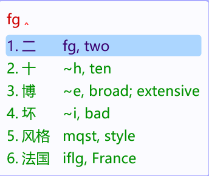

# rime-en-gloss

[](https://github.com/frank-yangfu/rime-en-gloss/releases)
[](LICENSE)
[](#install-manual-any-platform)
[](#install-manual-any-platform)
[](#how-it-works)
[](docs/quality-review.md)

> Show the **English meaning of every Chinese candidate** in the Rime candidate
> window (Weasel / Squirrel / ibus-rime / fcitx5-rime). Offline, no API key, no
> noticeable typing lag.



*Real screenshot: the English sits in the candidate comment slot, so pressing
space still commits the Chinese word.*

```
┌─────────────────────────────────────────────┐
│ wjjg                                        │
├─────────────────────────────────────────────┤
│ 1. 告诉    wjjg, to tell; to inform         │
│ 2. 东西    aiit, thing; stuff               │
│ 3. 结果    xfjs, result; outcome            │
└─────────────────────────────────────────────┘
```

## Why another one?

Most existing solutions either call an online translation API (key required,
often unreachable) or print the first CC-CEDICT sense verbatim, which is usually
the wrong one — `打 → dozen`, `告诉 → to press charges`, `吧 → bar`.
rime-en-gloss focuses on two things: **gloss quality** and **never freezing the
host application**.

## Install (manual, any platform)

```bash
# 1) the filter and its wubi-code list
cp lua/input_text.lua     <rime user dir>/lua/
cp lua/wubi_override.txt <rime user dir>/lua/

# 2) the table
cd tools
python fetch_cedict.py        # CC-CEDICT ~200k entries -> ../data/cedict.json
python build_cache.py        # -> $TMPDIR/rime_argos/cache.txt (96,784 entries)
#    add --dict-dir <rime user dir> to use the dictionary's real word weights
#    for ordering, and --out to write somewhere else

# 3) register the filter: save as <schema>.custom.yaml, then redeploy
#    patch:
#      "engine/filters/+":
#        - lua_filter@*input_text*filter
```

On Windows there is a one-shot installer: `powershell -File scripts\install.ps1`.

## How it works

```
CC-CEDICT ──► tools/glossary.py ──► tools/build_cache.py ──► cache.txt
              (sense picker +        (pure stdlib)            │
               hand-checked tables)                           │ incremental read
                                                              ▼
                                        lua/input_text.lua (candidate filter)
                                                              │ cache miss
                                                              ▼
                                          request.txt ── optional local MT
```

The filter runs **synchronously inside the input thread** of whatever program
you type into, so it does no HTTP, never execs a process, inspects at most 30
candidates, reads the disk only on a cache miss, and parses at most 40k lines
per keystroke. See `docs/how-it-works.md`.

It also keeps wubi and pinyin candidates apart. A few legal wubi codes split
into pinyin syllables as well (`yaa` = 试, but also `ya` + `a` = 鸭啊); the codes
that must stay wubi are listed in `lua/wubi_override.txt` (1,122 entries,
regenerated offline by `tools/gen_wubi_override.py`).

v1.5.0 ships a supplemental Wubi word dictionary (`wubi86.extended.dict.yaml`,
~147,000 entries) for ordinary words missing from the old base table (骑行 cdtf,
车店 lgyh, 异响 nakt, 扫码 rvdc …), plus a mixed mode: when an input is both pinyin
and an exact wubi word code, the wubi words come first and pinyin follows.
v1.5.1 restores short-code completions (`wq` → 你/低/像…) and gives single-letter
wubi codes priority (`o` → 为). v1.5.2 adds two-letter mixed mode (`wu` → 们/位置/
伴侣/无/五…). See `docs/wubi-words.md`.

## Data quality

| word | first CEDICT sense | what you get |
|---|---|---|
| 打 | dozen | to hit; to play |
| 告诉 | to press charges | to tell; to inform |
| 东西 | east and west | thing; stuff |
| 一次 | first | once; one time |
| 刘 | a type of battle-ax | (surname Liu) |

Achieved by: merging all dictionary entries of a word (CC-CEDICT splits one word
over several entries and the file order is not "most common sense first"),
resolving `variant of` chains including self-references, scoring every candidate
sense against a common-English word list, demoting proper-noun senses (otherwise
比萨 becomes "Pisa" and 大拇指 "Tom Thumb"), 1,700+ hand-checked overrides, and
dropping dictionary noise. Machine translation is deliberately **not** used to
generate entries — it produced things like `人不 → No, no, no`, `就能 → Yeah`.
See `docs/quality-review.md`.

## Layout

```
lua/input_text.lua          the only runtime component
lua/wubi_override.txt       wubi codes that must not be treated as pinyin
tools/glossary.py           hand-checked tables + sense picker
tools/build_cache.py        rebuild the table
tools/gen_wubi_override.py  regenerate the wubi-code list
tools/build_wubi_words.py   build the supplemental Wubi word dictionary
 tools/pinyin_keep.txt      curated pinyin words (generator input)
tools/fetch_cedict.py       download/convert CC-CEDICT
tools/optional_mt_server.py optional offline model service (long-tail words)
schema/add_filter.patch.yaml how to attach the filter
scripts/                    Windows installer & service launchers
docs/                       design notes, quality review, troubleshooting
data/wubi_words_extra.txt   hand-made entries for the supplemental dictionary
docs/wubi-words.md          supplemental Wubi words + full-pinyin config
docs/releases/              release notes, offline (v1.0.0 … v1.5.2)
```

## Author

Frank ([@frank-yangfu](https://github.com/frank-yangfu))

## License

Code: MIT. Dictionary data: [CC-CEDICT](https://cc-cedict.org/) (CC BY-SA 4.0),
downloaded locally at build time and not redistributed here.